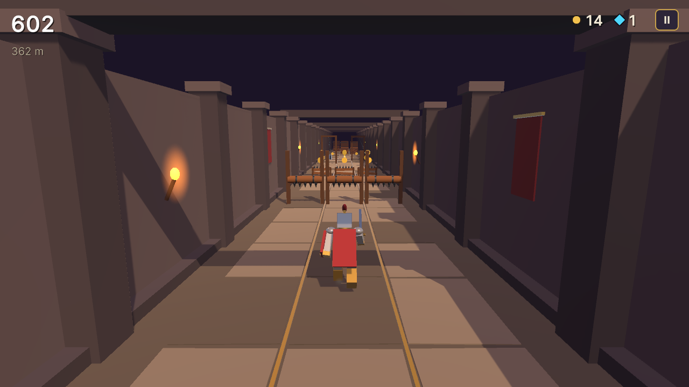
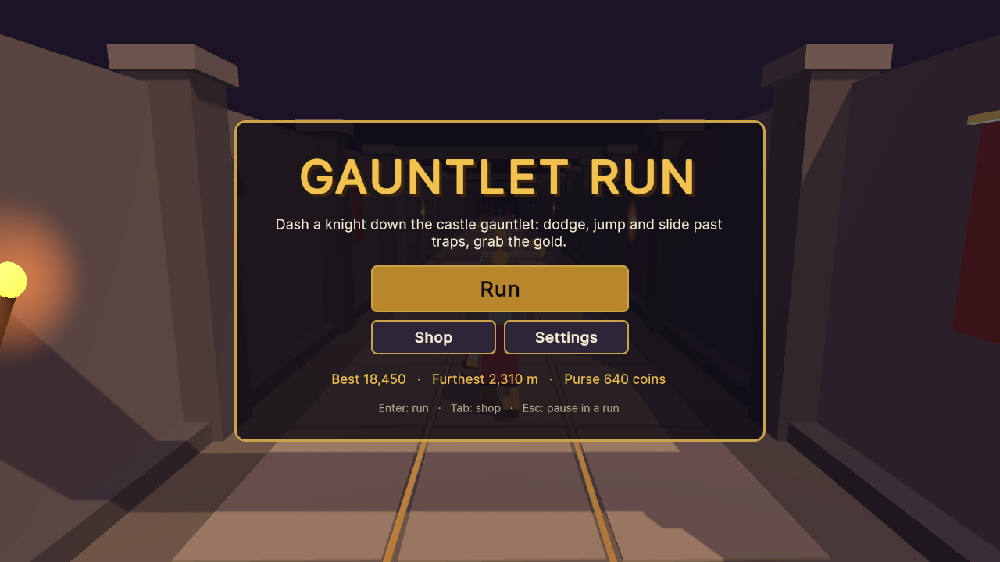
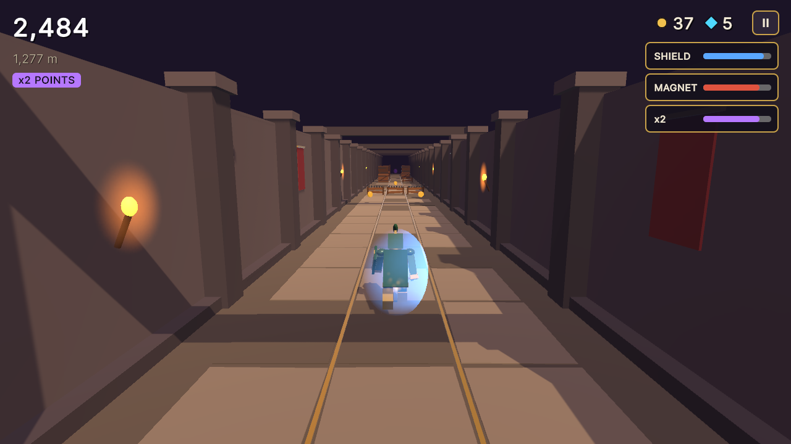
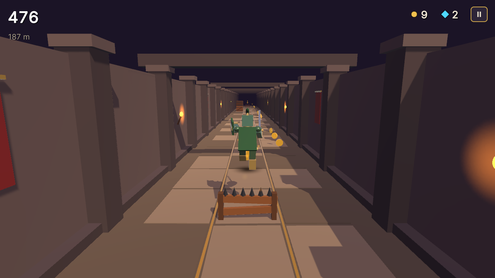
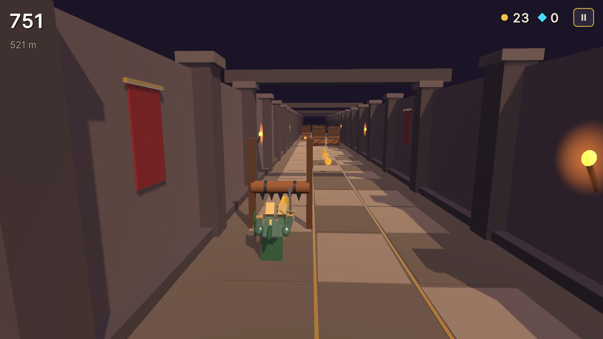
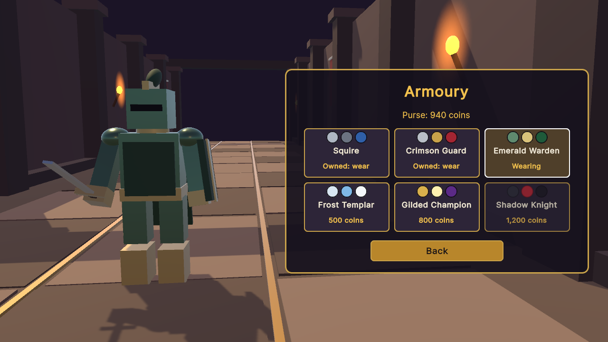
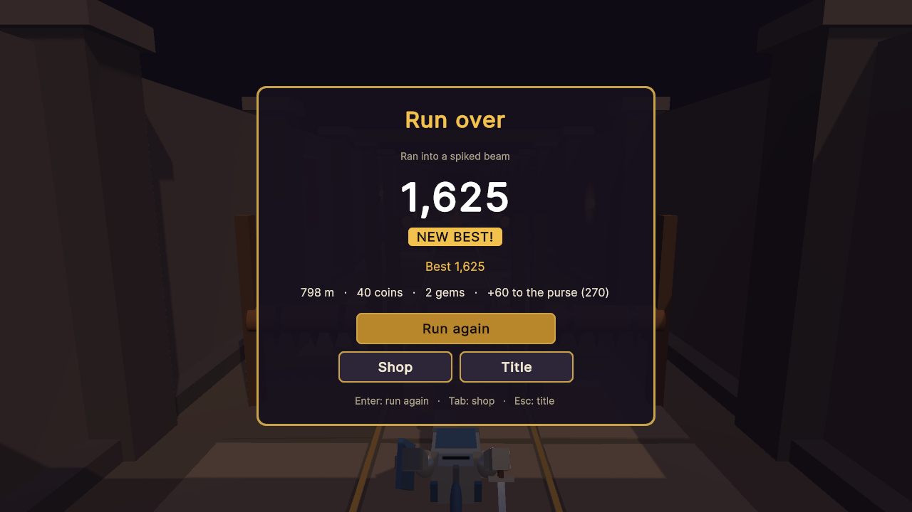

# Gauntlet Run

A small 3D endless runner built with Unity: a knight dashes down a torch-lit castle corridor,
changing lanes, jumping barricades and sliding under spiked beams while the speed keeps rising.



| | |
|---|---|
|  |  |
|  |  |
|  |  |

## Run it

1. Install **Unity 6000.3.27f1 (Unity 6 LTS)** with Unity Hub (add the Windows or Web build
   support module if you want to build players).
2. In Unity Hub choose **Add → Add project from disk** and select the repository folder.
3. Open `Assets/Scenes/Gauntlet.unity` and press **Play**.

To build a player use **File → Build Profiles** (Windows or Web), or build from a terminal into
a folder outside the repository:

```bash
Unity -batchmode -quit -projectPath . -executeMethod GauntletRun.EditorTools.ProjectBuilder.BuildWebGL -buildOutput ../build/web
```

(`BuildWindows` works the same way.) The WebGL build is uncompressed, so it runs from any
static host such as GitHub Pages.

The tests run from **Window → General → Test Runner** (EditMode and PlayMode), or from a terminal:

```bash
Unity -batchmode -projectPath . -runTests -testPlatform EditMode -testResults results.xml
Unity -batchmode -projectPath . -runTests -testPlatform PlayMode -testResults playmode.xml
```

The README screenshots come from an opt-in hook: run a built player with
`-screenshot <folder>` (optionally `-scenario title,run,jump,slide,powers,shop,pause,gameover`),
or, without a player,
`Unity -batchmode -projectPath . -executeMethod GauntletRun.EditorTools.ProjectBuilder.CaptureScreenshots -screenshot <folder>`.

The scene, materials and icon can be regenerated with **Gauntlet Run → Regenerate Art, Scene
and Player Settings**, and the audio with `python tools/audio/build.py` (needs ffmpeg).

## Controls

| Action | Keyboard | Gamepad | Touch / mouse |
|---|---|---|---|
| Change lane | A / D or Left / Right | D-pad or left stick left / right | Swipe left / right |
| Jump | W, Up or Space | A, D-pad or stick up | Swipe up |
| Slide (or drop from a jump) | S, Down or Left Ctrl | B, D-pad or stick down | Swipe down |
| Pause | Esc or P | Start | II button |
| Run / run again | Enter or Space (R on the results) | A (Y on the results) | Buttons |
| Shop | Tab | X | Shop button |
| Back (menus and shop) | Esc or Backspace | B | Back button |
| Resume from pause | Esc, P, Enter or Space | Start or A | Resume button |

## How it plays

- **The road.** Three lanes. It is laid out of hand-written patterns (rows of three cells such
  as `W.H` for a wall, an open lane and a hurdle), mirrored at random. Every row leaves at
  least one lane that can be passed.
- **Obstacles.** Barricades (jump), spiked beams (slide), crate walls (change lanes) and
  pendulum axes swinging across their lane (change lanes, or time it).
- **Difficulty.** Speed starts at 10 m/s and eases towards 24 m/s (halfway at 1,600 m). New
  patterns unlock at 300, 800, 1,500 and 2,500 m, the gaps between patterns shrink, and patterns
  stretch with speed so the time between rows stays fair.
- **Pickups.** Coins (10 points), gems (100 points, worth 10 coins in the purse), and three
  power-ups: a **shield** that smashes through one obstacle (15 s), a **magnet** that pulls in
  coins from every lane (10 s) and **double points** (10 s).
- **Score.** One point per metre plus pickups, doubled while double points lasts. A herald
  sounds every 500 m. The best score, furthest distance and the purse are saved on the device.
- **Armoury.** Spend coins on six knight skins, from the free Squire to the Shadow Knight.
- **Settings.** Music and effects volumes, from the title or the pause menu.

## What I learned / technically interesting

- **Rules without the engine.** Lanes, the jump arc with input buffering, slides, collisions,
  pickups, power-ups, the difficulty curve, the pattern generator, the session flow, the shop
  and the saved profile live in `Assets/Scripts/Core`, a plain C# assembly with no Unity
  references, covered by 57 EditMode tests. The Unity layer only renders, plays effects and
  reads input; 6 PlayMode tests drive the real scene (start, steering, crash and results,
  restart during the death beat, pause, shop).
- **A bot keeps the road honest.** `Autopilot` keeps to the lane with the most open road,
  jumps hurdles and slides under beams. One EditMode test lets it run 3.5 km on 25 seeds (all
  five tiers) and fails if it ever crashes, so a pattern that cannot be survived shows up as
  a red test. The same bot plays the attract run behind the title.
- **Fixed-step simulation.** The run advances in 1/60 s steps whatever the frame rate, and
  presses wait for the next step, so a slow frame plays out exactly like a fast one. After a
  crash the knight lies still for a beat; that beat belongs to the run, so restarting or
  leaving during it can never pop old results over a new run.
- **Plain-maths collisions.** No colliders and no physics module: the knight and every
  obstacle are boxes in the core, the axe blade's box follows its swing, and a slide lowers
  the knight's box under the beams.
- **Everything is generated.** The knight, the corridor and every prop are built from
  primitive meshes in code; materials, the scene, the app icon and the player settings come
  from an editor script (`ProjectBuilder.cs`); the music and sound effects come from a tiny
  Python synthesizer (`tools/audio`). The UI is UI Toolkit built in code, and input goes
  through the Input System, so keyboard, gamepad and touch swipes all work.
- **Rescuing old work.** This began in 2021 as my own Unity 2020.3 endless-runner template: a
  character sliding sideways on platforms spawned on a timer, coins, gems and a shield, all on
  Asset Store models that cannot be redistributed. It was upgraded to Unity 6, its rules were
  pulled out of the MonoBehaviours (fixing three bugs on the way, each shown by a failing test
  first: steering past the edge of the road, platforms overlapping because they were spawned
  on a timer, and spawners that never stopped because `StopCoroutine` was given a new
  enumerator), the store assets were removed, and the template was grown into the game above.

## Credits

Everything in the game was made for this project: models built in code, generated materials
and icon, synthesized audio, and Unity's default font. The Asset Store packs the original
template used were removed (see [CREDITS.md](CREDITS.md)).

## License

[MIT](LICENSE)
